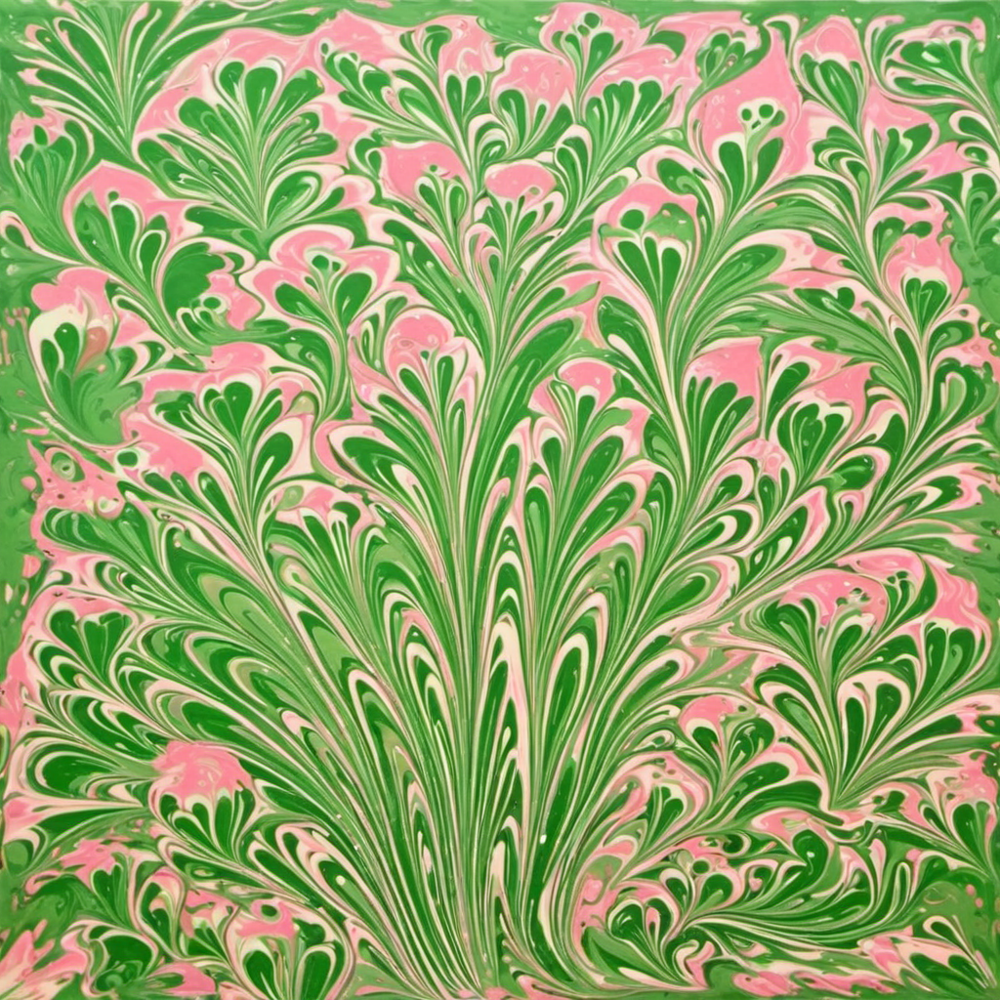

# 🎨 Ebru Art Generative AI Model (SDXL + LoRA)

An end-to-end Generative AI pipeline designed to synthesize traditional Turkish Ebru (Marbling) art patterns using Low-Rank Adaptation (LoRA) fine-tuned on Stable Diffusion XL (SDXL), served via a Flask REST API and ngrok secure tunneling.

---

## 📸 Generated Ebru Art Outputs

| Ebru Pattern Sample 1 | Ebru Pattern Sample 2 |
| :---: | :---: |
|  |  |

---

## 🏗️ System Architecture

```text
[ Custom Ebru LoRA + SDXL Base ] 
               │
               ▼ (Google Colab GPU Environment)
       [ Flask REST API ]
               │
               ▼ (ngrok Tunneling & Translation Layer)
       [ Remote Client / Web UI ]


Key Features
🖌️ Custom LoRA Fine-Tuning: Trained on a curated dataset of traditional Turkish Ebru artworks on top of SDXL architecture.

🌐 Smart Translation Middleware: Translates user inputs from Turkish to English on the fly using deep-translator for optimal prompt processing.

🥪 Dynamic Prompt Sandwiching: Blends user intent with master style tags (ebru art style, marble texture, liquid art) and LoRA trigger tokens (<lora:ebru_projesi-01:0.9>).

⚡ Dual-Mode Execution:

Production Mode: Forwards txt2img payloads to live GPU instances on Google Colab via ngrok.

Simulation Mode: Graceful fallback test pipeline when GPU is detached.

📊 Dataset Synthesizer Script (mega_dataset_generator.py): Automated batch image generator with 200+ curated prompts and CSV state management.


Tech Stack
Generative Model: Stable Diffusion XL (SDXL), LoRA

Backend & API: Python, Flask, Flask-CORS

Translation & Networking: GoogleTranslator (deep-translator), ngrok, Requests

Cloud & Hardware: Google Colab (GPU)

Frontend: HTML5, CSS3, JavaScript (Fetch API)


Note: Under TÜBİTAK research protocols and intellectual property protection, fine-tuned model weight files (.safetensors), uncurated raw dataset images, and sensitive API tokens are intentionally omitted from this repository. This repository demonstrates the end-to-end software architecture, translation pipeline, and API engineering.